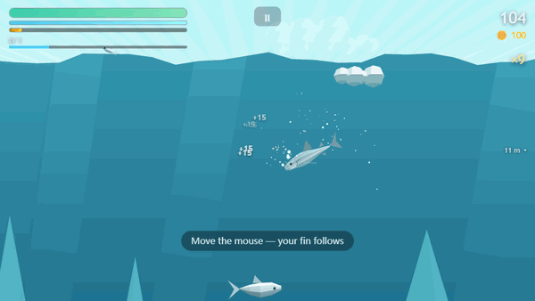
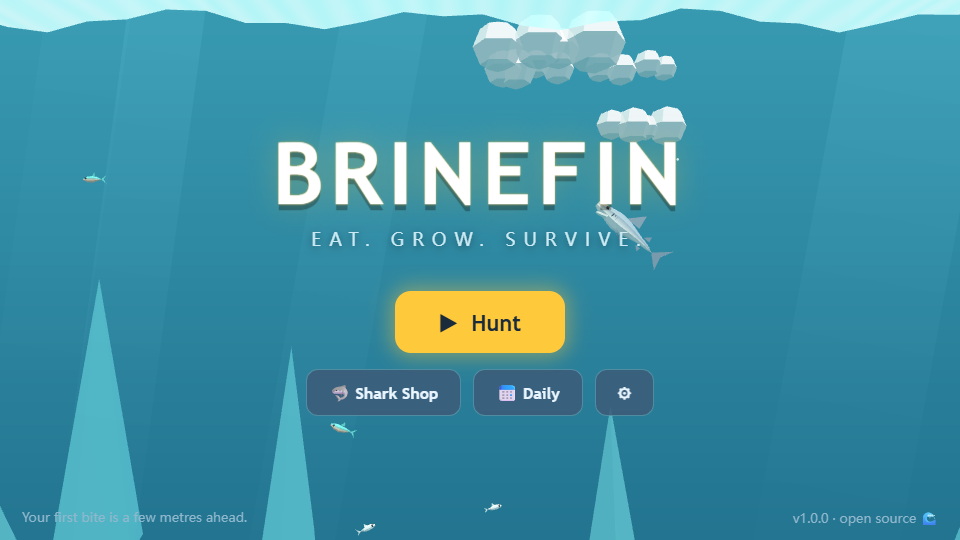
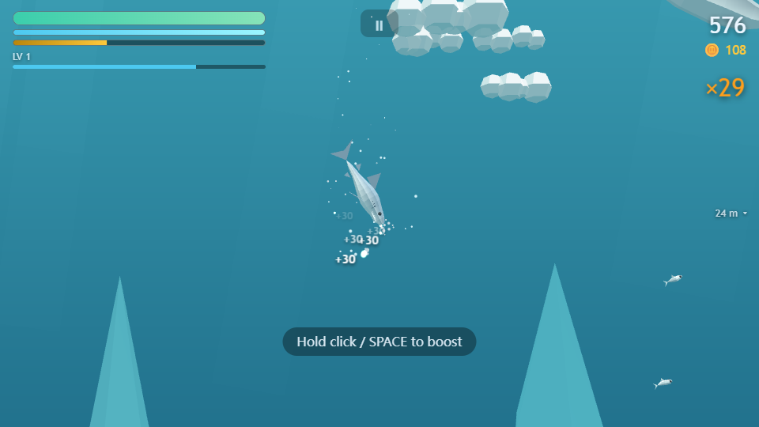

# Brinefin

A small shark arcade game for the browser: eat fish smaller than you, grow, and stay away from anything bigger. It runs on desktop and phones, with no install and no build step.

**Play it here: https://appleweiping.github.io/hungry-fin/**



The repository is still called `hungry-fin`, which was the game's first name. I renamed the game to Brinefin because the old name was too close to a commercial shark game.

[中文说明](README.zh-CN.md)

## Controls

| Action | Mouse / keyboard | Touch |
|---|---|---|
| Swim | Move the mouse (the shark follows the cursor), or `W` `A` `S` `D` / arrow keys | Drag on the left half of the screen (floating joystick) |
| Boost | Hold the left mouse button, `Space` or `Left Shift` | Hold the boost button |
| Bite | Automatic when your mouth reaches something you can eat | Same |
| Break out of a net | Tap boost repeatedly | Tap the boost button repeatedly |
| Pause | `Esc` or `P` | Pause button at the top |

Your hunger bar is also your health. It drains all the time and only eating refills it. Chaining bites builds a combo, a full gold bar starts a short Gold Rush where everything is edible, and coins earned in a run buy bigger sharks in the shop. Progress is saved in `localStorage` in your browser; there are no accounts.

| Title screen | Mid-run |
|---|---|
|  |  |

## Run it locally

```bash
git clone https://github.com/appleweiping/hungry-fin.git
cd hungry-fin
python -m http.server 8000     # then open http://localhost:8000
```

Opening `index.html` directly from disk also works, because the game uses plain `<script>` tags instead of ES modules.

`node tools/check.mjs` checks that every script parses and that the balance tables are consistent (unique ids, valid zones and depth ranges, food for the starting shark in every zone). CI runs the same check on every push.

## How it's built

- **Three.js r147, vendored.** `vendor/three.min.js` is the UMD build, committed so the game works offline and from `file://`. [vendor/README.md](vendor/README.md) explains why it is pinned below r160.
- **No image, model or audio files.** Sharks are lofted from cross-sections in `js/gfx/sharkBuilder.js`; fish, boats and bosses come from the same modelling kit in `js/gfx/modelKit.js`. Sounds are Web Audio oscillators and filtered noise (`js/audio/audio.js`).
- **One draw call per species.** Each creature type is an `InstancedMesh` (`js/game/entity.js`), and swimming is a small vertex-shader bend added to the stock materials with `onBeforeCompile` (`js/gfx/materials.js`).
- **Every tunable number is in one file.** Shark stats, the 28 creature rows, spawn targets, combo windows and prices live in [`js/data/balance.js`](js/data/balance.js). A new creature is a data row that reuses one of six behaviour types (`school`, `wander`, `flee`, `chase`, `hazard`, `surface`).
- **Load order is the dependency graph.** Modules attach to a global `HF` object and call `HF.require(...)` at the top, so a script in the wrong order in `index.html` fails at boot with a clear message.

## What I learned

- **An empty screen kills an arcade game faster than a hard one.** The starting shark only sees about 7 m of water from top to bottom, but creatures were spawned anywhere between 2 and 40 m deep, so the opening often looked like an empty ocean. Spawning near the player's depth, skipping species that cannot live there, and raising the population for the first 30 seconds fixed it without touching difficulty (`js/game/spawner.js`).
- **Toggling a light recompiles every shader.** Below about 100 m the shark carries its own light. Adding and removing a point light changes the light count, which makes Three.js rebuild every lit material and stutter, so the light is always present and only its intensity changes.
- **Hit-stop and slow motion fight each other** if both write one global time scale. The engine keeps separate time-scale channels and uses the minimum (`js/game/engine.js`), so a bite freeze cannot cancel the slow motion of a jump.
- **Touch input needs `pointercancel`.** When the OS takes a touch away (notification pull-down, edge swipe), the browser sends `pointercancel` instead of `pointerup`. Without handling it, the joystick stays stuck until a reload.

## Credits

The game is inspired by the shark-survival genre. All code, models, sounds, names and numbers in this repository were written for this project. Three.js is MIT licensed ([vendor/LICENSE-three.txt](vendor/LICENSE-three.txt)).

## License

[MIT](LICENSE)
