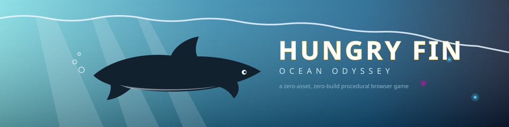
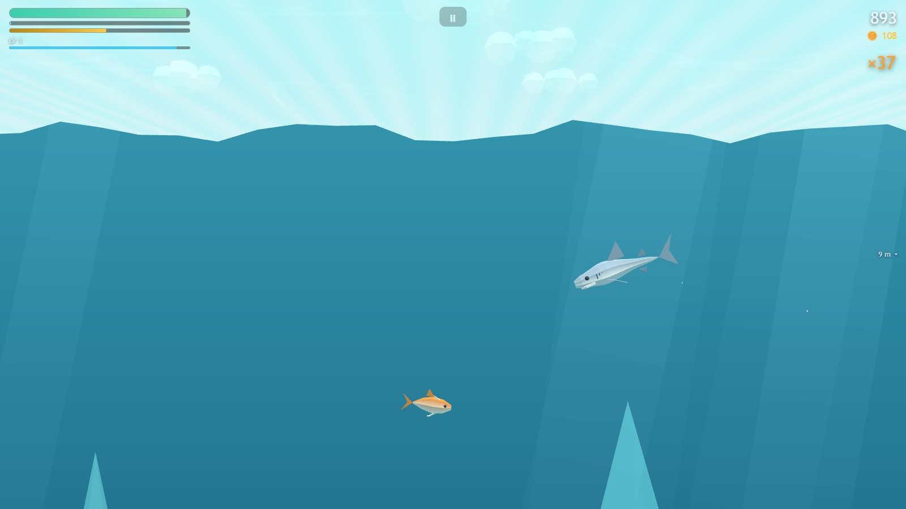
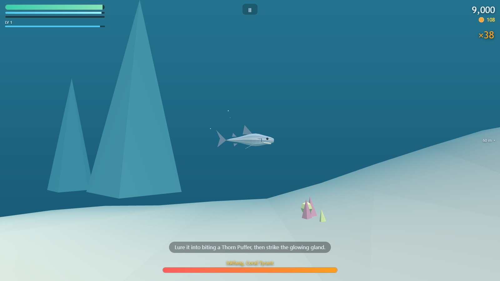
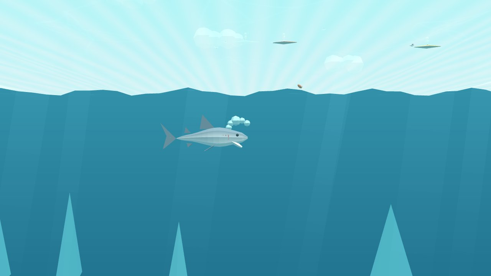
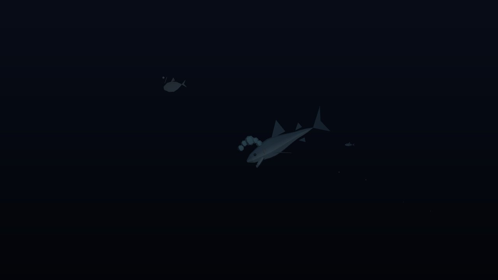

<p align="center">
  
</p>

<h1 align="center">🦈 Hungry Fin — 海洋奥德赛</h1>

<p align="center">
  <b>吞食、成长、生存。</b>一个从单个 <code>index.html</code> 就能运行的完整鲨鱼生存街机游戏——
  零构建、零打包器、零图片音频文件。所有模型由代码生成，所有音效实时合成。
</p>

<p align="center">
  <a href="https://appleweiping.github.io/hungry-fin/"><b>▶ 在浏览器里直接玩</b></a>
  &nbsp;·&nbsp;
  <a href="README.md">English</a>
</p>

---

> **声明** — Hungry Fin 是对"鲨鱼生存"这一游戏类型（由《饥饿鲨：世界》等作品发扬光大，
> Ubisoft / Future Games of London 出品）的**原创开源致敬**。本项目与上述游戏**没有任何隶属、
> 授权或派生关系**：仓库中的每一行代码、每一个 3D 模型、每一段声音、每一个名字和数值都是
> 为本项目从零创作的原创内容。如果你喜欢这个类型，也请去支持正版。

---

## 这是什么？

你是一条鲨鱼。海洋是自助餐。比你小的都是食物，比你大的对"你是不是食物"这件事有自己的看法。
维持饥饿条、叠连击、触发黄金狂潮（Gold Rush）、单局内成长、跨局攒金币，解锁七条鲨鱼、
三大海域、三只顶级掠食者 Boss、六只宠物和几顶帽子——然后潜得更深，再来一局。

| 觅食狂潮 | Boss 战 |
|---|---|
|  |  |

| 标题礁岩 | 深渊（你的鲨鱼就是灯） |
|---|---|
|  |  |

## 怎么玩

**在线试玩：** [appleweiping.github.io/hungry-fin](https://appleweiping.github.io/hungry-fin/)

**本地运行：** 克隆仓库后**双击 `index.html`** 即可——支持 `file://` 直接打开。
（本地服务器也行：`python -m http.server 8000`）

### 操作

| 动作 | 桌面端 | 触屏 |
|---|---|---|
| 游动 | 移动鼠标（鲨鱼追随指针）或 `WASD` / 方向键 | 左半屏浮动摇杆 |
| 冲刺 | 按住左键 / `Space` / `Shift` | 按住 ⚡ 按钮 |
| 咬合 | 自动——把嘴凑上去就行 | 自动 |
| 挣脱渔网/触手 | 连打冲刺键 | 连点 ⚡ |
| 暂停 | `Esc` / `P` | ⏸ 按钮 |

## 特性一览

**忠实重建的核心循环**

- **饥饿即生命。** 一条持续流失的条，进食是唯一解药。
- **阶级分明的食物链** —— 28 种生物横跨 7 个咬合等级。单局内升级（L1→L10）临时解锁更大猎物；
  买更大的鲨鱼永久往上爬。
- **连击系统**（窗口逐段收紧，分数 ×1→×5）+ **Gold Rush 充能槽**：充满触发 12 秒
  无敌、双倍分、见什么吃什么的黄金狂潮。
- **咬中返体力的冲刺**（内置 0.4 秒冷却）——机制层面鼓励进攻而非苟活。
- **跃出水面。** 半重力滞空、顶点慢动作、空中捕食分数 ×2。

**值得横渡的世界**

- 三大海域各有配色、雾效、生态与音阶：糖果色的**珊瑚浅滩**、辽阔的**开阔远洋**、
  以及**深渊**——那里你鲨鱼身上的潜水灯是唯一的光源。
- **三只顶级掠食者**共享一套 Boss 框架：诱使墨牙咬中刺胀河豚、引黑潮皇撞上沉船桅杆、
  一根根咬掉深渊之瞳的发光触手（小心墨汁）。
- 锚雷、热泉、水母、可挣脱的拖网（连打 QTE）、发射鱼叉的潜航器、12 个隐藏宝箱。

**持久化的成长（localStorage，无需账号）**

- **7 条鲨鱼**：从 1.2 米的礁尾鲨到 13 米的太古碾颚（集齐三个 Boss 首杀享折扣）。
- **6 只宠物**：吸金币、深渊照明、滞空增强、自动捕猎、每局一次的免死、电击驱赶追击者。
- **9 件饰品**（头/身/尾三槽位），加成上限约 10% 且只买便利性，从不卖数值。
- **15 个成就**（3 个隐藏）+ **按日期播种的每日挑战**——全球玩家每天同一组任务，零服务器。

**而且整个游戏都是程序化的**

- 鲨鱼由一个参数化生成器（截面放样）按数据表生成；鱼、人类、船只、Boss 用同一套建模工具箱。
- 尾摆、翅膀扇动、水母裙摆全部由注入 Three.js 标准材质的一段顶点着色器驱动——
  每个物种一个 `InstancedMesh`，一个 draw call。
- 13 个音效与生成式环境音全部是 WebAudio 振荡器 + 滤波噪声的实时合成。
  仓库里**没有任何**图片、模型或音频文件。

## 架构

经典 `<script>` 标签、单一全局命名空间、五个依赖梯队——`index.html` 里的加载顺序**就是**
依赖图，`HF.require()` 会在顺序错误时启动即报错。

```
index.html
├── vendor/three.min.js      Three.js r147 UMD，钉版 vendored（原因见 vendor/README.md）
└── js/
    ├── core/core.js         命名空间 · 数学 · 种子随机 · 事件 · 对象池 · 错误浮层
    ├── data/                palette.js（所有颜色）· balance.js（所有数值）
    ├── audio/audio.js       合成音效 + 分层生成式环境音
    ├── gfx/                 materials（摆尾 shader）· modelKit（放样）· sharkBuilder ·
    │                        builders（28 种生物）· water · environment · particles
    ├── game/                engine（timeScale 通道栈）· save · input · cameraRig ·
    │                        entity+grid · ai（6 种行为原型）· spawner · player ·
    │                        combat · systems（GR/宠物/金币/渔网）· boss · progression
    └── ui/                  hud · screens · shop（scissor 裁剪的 3D 预览）
```

几个值得"偷走"的设计决策：

- **timeScale 通道栈** —— 顿帧、运镜、慢动作各占一个通道取最小值，咬合定格永远不会打断跃水慢放。
- **双层吞食判定** —— 物理层（嘴部圆 + 扫掠线段，冲刺不穿模）之上叠手感层（朝向锥 + 定距磁吸）；
  咬合半径只按视觉成长的一半增长且有上限——变大应该带来力量感，而不是取消瞄准。
- **六种行为原型**（群游/独游/受惊逃逸/主动追击/固定危险物/水面单位）驱动全部 28 种生物；
  新生物是一行数据，不是新代码。
- **纯局部种群** —— 屏幕外一圈生成环带持续补满目标数量，超出即回收，游到哪里密度都恒定。
- **玩家即光源** —— 100 米以下你的鲨鱼渐亮一盏潜水灯；灯常开在 ε 强度，
  因为切换灯光**数量**会触发全场景着色器重编译。
- **默认防御式编程** —— 存档版本迁移 + 防 `__proto__` 污染合并 + 损坏值兜底、
  `pointercancel`/`blur` 输入恢复、WebGL 上下文丢失处理、DPR 感知的尺寸轮询、
  帧率下降时自动降档的性能熔断。

## 数值党看这里

完整经济都在 [`js/data/balance.js`](js/data/balance.js)：鲨鱼属性、28 行生物表、
连击窗口 `5s/4s/3s`、GR 充能率 ×0.6（GR 期间与 Boss 战中冻结）、金币 = `⌊分数/60⌋`、
XP 曲线 `80·1.5^(L−1)`。节奏目标：下一件可购项永远 ≤8 局；全鲨约 5 小时，全收集约 8 小时。

## 它是怎么做出来的

本项目由 [Claude Code](https://claude.com/claude-code) 端到端完成，是一次认真的**多智能体
对抗式开发**实践：三个专家 agent（玩法设计 / 引擎架构 / 手感打磨）并行起草规格，
一个对抗评审 agent 攻击合成方案并冻结裁决版规格；照规格实现后，又有三个审查 agent
（正确性与经济 / 渲染与性能 / 健壮性与跨环境）审计成品代码——47 项发现，33 项确认并修复，
最后由 CDP 驱动的自动化回归**真实地玩了一遍游戏**（觅食、Gold Rush、完整击杀一只 Boss、
死亡结算、商店、存档持久化），控制台零错误。

## 路线图

- [ ] 手柄支持
- [ ] 更多海域（极地冰架、海底火山）与第四只顶级掠食者
- [ ] 拍照模式
- [ ] 固定种子的竞速模式与成绩分享
- [ ] 游戏内文本 i18n（代码已就绪——所有字符串集中在 UI 模块）

## 参与贡献

欢迎 PR，但有几条底线：

1. **不引入构建工具。** 需要 `npm install` 的一律不合。
2. **不引入二进制素材。** 模型是代码，声音是合成，颜色出自 `palette.js`。
3. **数值进 `balance.js`**，颜色进 `palette.js`——禁止内联。
4. 保住 `file://`：不用 `fetch`、不用 ES modules、只用相对路径。
5. 新生物应当是使用六种现有行为原型的数据行。

## 许可证

[MIT](LICENSE) —— vendored 的 Three.js 保留其自身 MIT 许可
（[vendor/LICENSE-three.txt](vendor/LICENSE-three.txt)）。

---

<p align="center">🌊 <i>海洋受理投诉。归档在"鲨"字头下。</i> 🌊</p>
